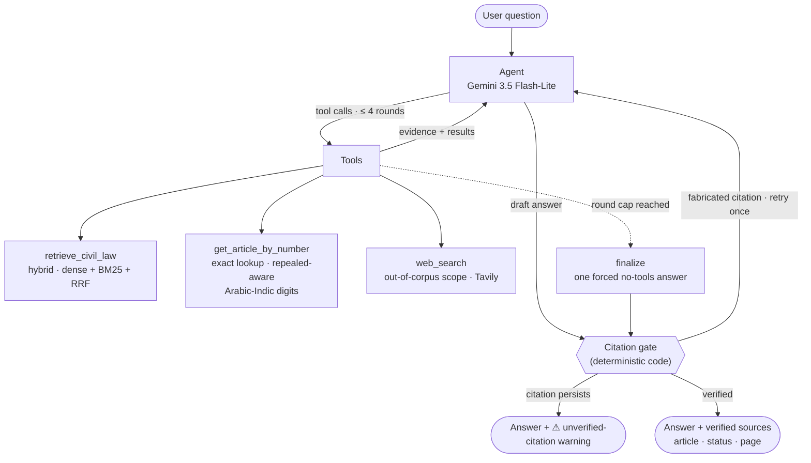

# LegalAI — Agentic RAG over the Egyptian Civil Code

An agentic retrieval-augmented-generation system that answers **Arabic legal
questions** about the Egyptian Civil Code (1948) with **verified, cited answers**.
Local-first: every article is indexed, extracted and retrieved offline; the LLM
is only used for reasoning, never as the source of truth.

**Every citation is machine-checkable.** A deterministic, code-side gate rejects
any answer that cites an article number absent from retrieved evidence — no
trusting the LLM.

## What it does



- **Agentic loop** — the model decides which tools to call, rephrases and re-searches
  when results disappoint (query-crafting is part of the system prompt), with provider
  guards for Groq malformed tool calls and a round cap that forces a final answer
  (Gemini loop-guard).
- **Deterministic citation gate** — article numbers are regex-extracted from the
  answer and checked against the evidence set. Fabrications bounce back once with a
  corrective note; surviving ones are surfaced to the caller (`bad_citations`).
  Web-only answers are exempt by design (their sources can't be verified code-side).
- **Hybrid retrieval** — dense embeddings (Qwen3-Embedding-0.6B) + BM25 fused with
  reciprocal rank fusion. Improvements are *measured*, see [results](#measured-results).
- **Scope awareness** — questions outside the civil code route to web search with
  sources cited; traps (nonexistent articles, other-law articles) are refused honestly.
- **Conversation memory** — `ask(question, history)` replays prior turns so
  follow-up questions work.
- **Corpus with provenance** — 1,151 records extracted from the official PDF
  (1,094 in force, 56 repealed, byte-reproducible extraction) with page numbers,
  section paths and legal status per article.

## Measured results

All numbers are reproducible from this repo — commands in
[Reproducing the evaluation](#reproducing-the-evaluation). No LLM is involved in
the retrieval metrics; agent metrics run the real graph end-to-end.

### Retrieval (40 hand-built golden questions, one shared index per embedder)

| Search mode | Recall@5 | MRR | Query time |
|---|---|---|---|
| BM25 only (sparse) | 0.57 | 0.47 | 2 ms |
| Dense only (vector) | 0.70 | 0.58 | 167 ms |
| **Hybrid (RRF)** | **0.85** | **0.66** | **37 ms** |

Hybrid beats semantic-only by **21% relative recall@5** while being 4.5× faster,
and BM25-only shows why fusion matters (dense alone misses nothing but exact
legalese; sparse alone misses paraphrases).

### Agent, end-to-end (60 golden + 224 external answers = 284 evaluated)

| Metric | Value | How |
|---|---|---|
| Grounded answers (civil-law) | **89%** (104/117) | LLM-as-judge vs verbatim law text |
| Source-consistent web answers | 65% (n=166) | LLM-as-judge vs the exact snippets used |
| Citation accuracy (civil) | 85% (99/117) | regex-extracted citations vs expected articles |
| Honest handling of traps / out-of-scope | **99%** (166/167) | deterministic checks |
| Out-of-scope → web routing | 99% (166/167) | logged tool calls |
| Fabricated citations | 0 on the 60-question hand-verified suite | citation gate + run logs |
| Avg latency | 14.4 s | sequential runs, free-tier LLMs |

Honesty notes, kept on purpose: the judge runs on the same Gemini model family as
the agent (cross-provider key had expired), so 89% reads as an optimistic ceiling;
the external benchmark's labels are auto-audited, not human-reviewed, so the
85% citation figure is a floor; the golden set is 60 questions of which 48 are
flagged `verified: true` in the data.

## Quickstart

```bash
git clone <repo> && cd LegalAI
uv sync                        # or: pip install -e .
cp .env.example .env           # add GEMINI_API_KEY (or GROQ/OPENROUTER), TAVILY_API_KEY

# build the local indexes (once)
python -m legal_agent.ingest

# terminal
python -m legal_agent "ما نص المادة 163؟"

# web UI (FastAPI serves a single vanilla-JS RTL page — no framework, no build step)
.venv/bin/uvicorn legal_agent.api:app --port 8000   # then open http://localhost:8000
```

API: `POST /ask {"question": "...", "history": [...]} → {answer, sources,
bad_citations, articles_retrieved, web_used}` — `sources` carry article number,
legal status, section path and page.

## Reproducing the evaluation

```bash
# retrieval bake-off (no LLM, ~5 min): mode comparison on the golden set
.venv/bin/python scripts/eval_retrieval.py --embedders qwen3-0.6b --modes vector,sparse,hybrid

# full agent run over a question set (resumable JSONL, one row per question)
.venv/bin/python scripts/eval_answers.py --eval-file eval/golden_set.json --out eval/runs/golden.jsonl
.venv/bin/python scripts/eval_answers.py --eval-file eval/external_v2_subset.json --out eval/runs/ext.jsonl

# LLM-as-judge over a run: civil rows vs verbatim law text, web rows vs their own sources
.venv/bin/python scripts/judge.py --run eval/runs/golden.jsonl --out eval/runs/judged.jsonl
```

Run logs in `eval/runs/` are the receipts for the numbers above.

## Project structure

```
legal_agent/
  agent.py       LangGraph state machine: tool loop + citation gate + guards
  prompts.py     the one file where answer behavior is tuned
  tools.py       the 3 agent-facing tools (retrieval / exact fetch / web)
  retrieval.py   vector + sparse + hybrid (RRF) search, repealed fallback
  embeddings.py  4 swappable embedders, embedder/index consistency guard
  ingest.py      JSON → Chroma + BM25 index build
  citations.py   citation extraction + verification gate
  api.py         FastAPI wrapper + static page
  cli.py         terminal REPL / one-shot
scripts/
  extract_civil_law.py   PDF → validated JSON corpus (articles 1–1149)
  eval_retrieval.py      retrieval bake-off (embedder × mode)
  eval_answers.py        agent end-to-end runner (resumable JSONL)
  judge.py               LLM-as-judge over a run
eval/            golden set (60), external benchmark (516), runs/
tests/           29 tests, agent mocked — no LLM needed to run the suite
```

## Design decisions worth stealing

- The citation gate is **code, not an LLM**: cannot be sweet-talked, costs nothing.
- Tools **never raise** — provider errors become structured `{"error": ...}` JSON
  the model can read and route around.
- Query crafting lives in the **system prompt** (measured before being promoted to
  a dedicated node — the prompt alone moved the retrieval-bridge misses).
- Everything evaluable is evaluated **before** it is designed in: the rewriter was
  planned as a node, shipped as a prompt rule, and the hybrid/semantic comparison
  dataset is what justified keeping RRF.

## Roadmap

- [ ] Streaming responses (SSE)
- [ ] Cross-provider judge (remove the same-model caveat)
- [ ] Docker + deployment guide
- [ ] Reranker on the hybrid top-k (`bge-reranker` already in HF cache)

## License

MIT. The external benchmark derives from HF `tarekys5/egyptian_legal_v2`
(validation split, Apache-2.0); original questions are excluded, article texts
are public-domain law.
